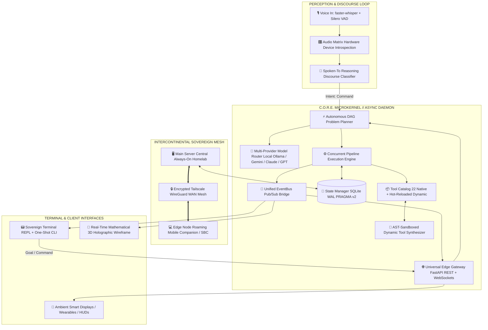

# C.O.R.E. AI :: SYSTEM RELEASE PROTOCOL
### KERNEL PROTOCOL v0.2.2-alpha // CODENAME: "DISTRIBUTED VOICE SATELLITES & MOBILE MESH"

```text
   ______ ____  ____  ______   ___    ____
  / ____// __ \/ __ \/ ____/  /   |  /  _/
 / /    / / / / /_/ / __/    / /| |  / /  
/ /___ / /_/ / _, _/ /___   / ___ |_/ /   
\____/ \____/_/ |_/_____/  /_/  |_/___/   

CONCURRENT OMNIPRESENT REASONING ENGINE // SOVEREIGN LIFE OS
```

| Kernel Version | Operational Status | Verification | Sovereign Ethos |
| :---: | :---: | :---: | :---: |
| **`v0.2.2-alpha`** | 🟢 **OPERATIONAL** | 🧪 **180 / 180 PASSED** | 🛡️ **#ANTISLOP** |

| Mesh Storage | Cryptography | Telemetry | License |
| :---: | :---: | :---: | :---: |
| **SECURE WAL-MODE** | **256-BIT SOVEREIGN** | **0.00% (ZERO)** | **AGPL-3.0** |


> [!IMPORTANT]
> **The Sovereign Commitment:**
> Core AI is not a commercial product, a cloud wrapper, or a corporate data siphon. It is a **Sovereign Local Life Operating System** designed to return absolute technological autonomy, compute efficiency, and cryptographic privacy to the individual operator.
> 
> *Lead Architect:* **Dyvorn** (*aka Vyrn / Refined*) • **Source:** [`github.com/Dyvorn/Core-AI`](https://github.com/Dyvorn/Core-AI)

---

## ⚡ C.O.R.E. DECODED

```text
[C] CONCURRENT   ──► Asynchronous DAG pipeline execution. Solves multiple dependent & parallel sub-tasks simultaneously.
[O] OMNIPRESENT  ──► Pervasive across living spaces, workstations, homelabs, vehicles & wearables without central cloud lock.
[R] REASONING    ──► High-order discourse discrimination, intentionality detection & dynamic multi-provider routing.
[E] ENGINE       ──► Self-healing microkernel, AST-sandboxed dynamic tool synthesis & sovereign local authority anchor.
```

---

## 🏛️ THE #ANTISLOP MANIFESTO

Technology must elevate humanity—not extract rent, hoard behavioral telemetry, or pump low-effort corporate cash grabs.

```text
├── 1. RADICAL ANTI-SLOP & ZERO TELEMETRY
│      No telemetry pingbacks. No corporate metrics SDKs. No targeted profiling.
│      Your thoughts, plans, files, voice streams, and spaces remain encrypted on your hardware.
│
├── 2. PLANETARY RESOURCE INTEGRITY
│      Industrial AI data centers burn massive electric grids and evaporate billions of liters
│      of potable drinking water for evaporative cooling.
│      Core AI terminates unnecessary cloud compute: deterministic heuristic pipelines solve
│      routine operations in <10ms with ZERO external inference calls.
│
├── 3. 100% CHARITY & NON-EXPLOITATION PLEDGE
│      Core AI will never monetize your home or life. If sponsorships or donations are ever
│      accepted, 100% of proceeds are routed directly to verified ecological and humanitarian
│      charities (potable water access, reforestation, and disaster relief).
│
└── 4. TERMINAL SUPREMACY & DECOUPLED CLIENTS
       Zero hardcoded web UI bloat inside the kernel. The core microkernel communicates strictly
       via fast ANSI terminals, a real-time 3D vector wireframe engine, and high-concurrency
       WebSocket streaming (/ws/events, /ws/logs, /ws/nodes/{id}). External HUDs and mobile
       displays connect as decoupled edge clients.
```

---

## 🛰️ SYSTEM ARCHITECTURE TOPOLOGY  (MADE WITH HELP OF AI)



---

## 📦 GENESIS FEATURE CAPABILITY MATRIX

### 1. Concurrent Autonomous DAG Pipeline Engine
```text
MODULE: brain/pipeline_engine.py & brain/planner.py
STATUS: PRODUCTION-HARDENED
```
* **Parallel Graph Traversal:** Breaks complex natural language requests into concurrent topological execution steps. Non-dependent steps execute simultaneously over `asyncio` worker pools.
* **Dynamic Variable Cascading:** Intermediate tool outputs map cleanly into downstream parameters using `{{steps.<id>.output.<field>}}` templates.
* **Jarvis Self-Healing Recovery:** If a step fails, Core AI diagnoses the underlying exception, calculates an autonomous remedy, re-plans the dependency graph, and continues execution seamlessly.
* **Deterministic Heuristic Instant Execution:** Bypasses LLM latency for frequent commands (hardware status, time, file operations, weather, calculations), completing jobs in **< 10ms**.

---

### 2. Sovereign Identity & Day-Zero Blank Slate
```text
MODULE: interfaces/cli/setup_wizard.py & core/state.py
STATUS: ABSOLUTE PRIVACY ISOLATION
```
* **Zero Pre-Baked Identities:** The repository ships completely clean. No default usernames, accounts, personal directories, or pre-seeded database rows exist in Git.
* **First-Run Wizard:** Automatically launches upon initial startup if an unconfigured database is detected. Prompts for:
  1. Operator Call Sign & Aliases
  2. Primary Physical Space (Office, Sanctuary, Studio, Lab)
  3. Persona & Communication Tone (Tactical Direct, Friendly Concise, Casual)
  4. Local vs. Cloud Model Backends
* **256-Bit Cryptographic Sovereign Secret:** Automatically generates a high-entropy auth secret saved to local `config/.env` for authenticating remote nodes into the `OWNER` tier.
* **Factory Reset Command:** `core reset` or `core account reset` wipes all dynamic spaces, enrolled devices, and profiles back to Day-Zero with zero lingering artifacts.

---

### 3. Intercontinental Sovereign Mesh & Zero-Friction Enrollment
```text
MODULE: core/mesh_client.py & interfaces/install/enroll.py
STATUS: WAN OPERATIONAL
```
* **Decentralized Role Architecture:**
  - **`main_server`**: The always-on host holding the primary database, active DAG scheduler, and edge registry.
  - **`edge_node`**: Roaming laptop, smartphone, or vehicle unit that proxies goals to the main server when connected, or falls back to autonomous local heuristic planning when offline.
* **State Bundle Portability:** Instant machine migration with atomic export and import:
  ```bash
  core "mesh export"   # Packs SQLite state, topology & profile into encrypted bundle
  core "mesh import bundle.json" # Restores onto a brand new machine in seconds
  ```
* **Zero-Friction Device Onboarding:**
  ```bash
  python -m interfaces.install.enroll --server http://core-host:8000 --secret "YOUR_SECRET"
  ```

---

### 4. Ambient Neural Perception, Silero VAD & Verbal Barge-In
```text
MODULE: brain/spoken_to.py, engines/voice_in.py, engines/voice_out.py, & core/gateway.py
STATUS: SUB-SECOND NEURAL AUDIO & INSTANT BARGE-IN INTERRUPT
```
* **Neural Silero VAD (ONNX):** Replaced crude RMS energy thresholding with on-device neural voice activity detection processing 512-sample (32ms at 16kHz) frames. Accurately pinpoints speech onset, rejects keyboard clicks, breathing, and room fan noise, and cleanly finalizes speech after ~350ms of silence (eliminating 7.0s safety delays).
* **Instant Verbal Barge-In & Speech Interruption:** Operator can interrupt Core AI mid-speech at any time by saying *"Stop"*, *"Stopp"*, *"No, no, stop, stop, stop"*, *"Halt"*, or *"Warte"*. The audio output worker halts hardware playback in <20ms and purges pending queues.
* **Fast-Path Semantic Discourse (<0.1ms Latency):** Discourse analysis evaluates direct room imperatives, time queries (*"what time is it"*, *"how... what time is it"*), and assistant vocatives (*"Gemini"*, *"Core"*, *"Jarvis"*) instantly before falling back to any external cognitive LLM.
* **Greedy Low-Latency Faster-Whisper Decoding:** Decoder configured with `beam_size=1`, `temperature=0.0`, and bilingual acoustic keyword priming, delivering 3-4x faster transcription throughput on CPU and sub-100ms on GPU.
* **Decoupled Asynchronous Audio Capture:** Microphone processing runs in an isolated non-blocking loop with background dispatch, keeping voice detection receptive 100% of the time even while executing tools or synthesizing audio.
* **Always-On Voice Capture Lifecycle:** Inverted voice activation lifecycle so microphone capture is always online by default across interactive REPL and headless background daemon modes. Operators can pause on-demand with `voice off` / `mic off` and resume with `voice on`, or start with `--no-voice` / `CORE_DISABLE_VOICE=1`.
* **Hardware Sample Rate Auto-Detection & Resampling:** Dynamically discovers native device rates (WASAPI / DirectSound 44.1kHz or 48kHz audio interfaces), completely resolving `PaErrorCode -9997 (Invalid sample rate)`. Integrates zero-dependency fast linear interpolation downsampling directly to Whisper's 16kHz stream.
* **Pre-Roll Audio Ring Buffer:** Circular ~320ms buffer prepended the moment speech onset is confirmed, preserving opening syllables ("Hey...", "Core...", "Wie...", "What...").
* **Four-Role Discourse Pragmatics Engine:** Core AI understands natural social context before speaking:
  - `ADDRESSED` ── Operator commands Core AI or gives natural room imperatives (reminders, git, notes, ram) ──► **Executes Pipeline**
  - `DEMONSTRATED` ── Operator showcases Core AI to guests/friends ──► **Chimes In Autonomously**
  - `REFERENCED` ── Operator talks *about* Core AI in 3rd person / past tense ──► **Stays Politely Silent**
  - `BYSTANDER` ── Ambient background conversation between humans ──► **Completely Ignored**
* **Wake-Word-Free Directives & Filler Stripping:** Seamlessly recognizes room imperatives (`"erinnere mich in 5 Min..."`, `"watch ram"`, `"git status"`) and cleanly peels conversational particles (`"Core, bitte zeig mir den git status"` $\to$ `"git status"`).
* **REST Discourse Endpoint:** External edge satellites and displays can evaluate discourse intention via `POST /api/v1/voice/spoken_to`.
* **Neural TTS Matrix:** Crystal-clear speech synthesis using Edge Neural TTS with offline `pyttsx3` fallback.
* **Spatial Audio Matrix:** Dynamic ALSA/WASAPI hardware device discovery binding zone locations to dedicated multi-channel soundcards with automatic spatial room handoff.

---

### 5. Terminal-Native 3D Holographic Rendering Engine
```text
MODULE: core/animation.py
STATUS: REAL-TIME WIREFRAME ENGINE
```
* **Floating-Point Mathematical Projection:** Complete 3D vector graphics calculated using real-time rotation matrices and depth-sorted floating-point Z-buffering in pure Python terminal space.
* **3 Geometric Topological Models:**
  1. *Quantum Gyroscopic Core* — Nested rotating multi-axis orbital rings with pulse nodes.
  2. *4D Hypercube (Tesseract)* — 8-cell 4D-to-3D-to-2D geometric stereographic projection.
  3. *Hexagonal Sovereign Monolith* — Faceted crystalline power core.
* **5 TrueColor Palette Themes:** Cyber Cyan, Sovereign Void, Matrix Emerald, Solar Flare, and Hyper Steel.
* **Interactive Live Keyboard Navigation:** Real-time camera orbital rotation (`WASD`), model switching (`M`), theme cycling (`T`), and animation pause (`Space`).

---

### 6. 24/7 Headless Daemon & Daily Driver CLI
```text
MODULE: core/service.py, core.bat, core.sh
STATUS: INSTANT DISPATCH (<100ms)
```
* **Operating System Native Service:** Pure `kernel32.OpenProcess` Win32 and POSIX process control without flaky subprocess wrappers.
* **Lifecycle Management:**
  ```bash
  core start     # Spawns 24/7 headless background server
  core status    # Displays live ANSI status card with PID, memory, and gateway state
  core stop      # Gracefully shuts down server, freeing GPU VRAM and system RAM
  ```
* **Instant One-Shot Command Dispatch:** Direct execution from any terminal without entering the interactive shell:
  ```bash
  core "what time is it"
  core "open discord and check system status"
  ```

---

## 💻 INTERACTIVE TERMINAL EXPERIENCE (PREVIEW)

```text
+=====================================================================+
|   CORE AI :: DAEMON & GATEWAY STATUS CARD                           |
+=====================================================================+
|   Daemon Process:   ONLINE (PID 12116)                              |
|   Universal Gateway:ONLINE (http://localhost:8000)                  |
|   Active Operator:  Dyvorn                                          |
|   Active Model:     gemini/gemini-2.5-flash                         |
|   Connected Nodes:  0                                               |
+=====================================================================+

Core [Dyvorn@office] > solve check system status and get time
[*] Decomposing goal with Planner: 'check system status and get time'
[+] Synthesized Pipeline DAG: 2 steps (ID: 41716bcb)
    - Step 's1': Get Time -> tool 'get_time' (independent)
    - Step 's2': Hardware Metrics -> tool 'get_hardware_metrics' (independent)

[*] Executing pipeline concurrently...
[OK] Pipeline Succeeded in 0.31s!

Core AI: System operating at optimal capacity. CPU is at 8.2%, memory at 41%, and the local time is 18:11.
```

---

## 🔒 SECURITY & ACCESS MATRIX

Core AI enforces three strict trust boundaries across all network connections:

```text
┌─────────────────┬─────────────────────────────────────────────────┬───────────────────────────────┐
│ TRUST TIER      │ CAPABILITIES & PRIVILEGES                       │ ENROLLMENT REQUIREMENT        │
├─────────────────┼─────────────────────────────────────────────────┼───────────────────────────────┤
│ 👑 OWNER        │ Full DAG Execution, Shell Command Tooling,     │ Cryptographic 256-Bit         │
│                 │ Process Termination, AST Tool Generation,       │ CORE_AUTH_SECRET Handshake    │
│                 │ State Migration, Mesh Relocation                │                               │
├─────────────────┼─────────────────────────────────────────────────┼───────────────────────────────┤
│ 🛰️ AMBIENT      │ Room Telemetry Ingestion, Spatial Audio Route   │ Pre-Enrolled Fixed Device     │
│                 │ Relocation, HUD Card Notification Broadcasts    │ Session Token                 │
├─────────────────┼─────────────────────────────────────────────────┼───────────────────────────────┤
│ 👤 GUEST        │ Restricted Querying, Mathematical Calculations, │ Public Gateway Endpoint       │
│                 │ Public Weather, General Knowledge Lookups       │ (Zero Credentials Required)   │
└─────────────────┴─────────────────────────────────────────────────┴───────────────────────────────┘
```

---

## ⚡ 60-SECOND QUICKSTART

### Windows (Automated One-Liner)
```powershell
irm https://raw.githubusercontent.com/Dyvorn/Core-AI/master/install.ps1 | iex
```

### Linux / macOS (Automated One-Liner)
```bash
curl -fsSL https://raw.githubusercontent.com/Dyvorn/Core-AI/master/install.sh | bash
```

### Manual Installation
```bash
# 1. Clone repository
git clone https://github.com/Dyvorn/Core-AI.git
cd Core-AI

# 2. Initialize virtual environment
python -m venv .venv

# 3. Install verified dependencies
# Windows:
.venv\Scripts\pip install -r requirements.txt
# Linux/macOS:
.venv/bin/pip install -r requirements.txt

# 4. Launch Core AI
# Windows:
.\core.bat
# Linux/macOS:
./core.sh
```

---

## 🛠️ CLI CHEAT SHEET

```text
CORE AI :: COMMAND REFERENCE
Usage: core <command> or core "<goal>"

LIFECYCLE:
  core                Launch interactive sovereign terminal shell
  core run            Launch interactive sovereign terminal shell
  core start          Spawn 24/7 background headless server daemon
  core stop           Gracefully terminate background daemon & free GPU/RAM
  core restart        Restart background server daemon
  core status         Inspect running server status card, PID, and health
  core account        Inspect Sovereign Operator Account identity matrix
  core account setup  Launch interactive wizard to update profile/models
  core reset          Factory reset database and account back to Day-Zero
  core version        Inspect Kernel version, commit hash, node role, and mesh URL
  core mesh ping      Probe round-trip latency & inspect gateway cognitive status
  core clean          Clean slate zero-residue wipe of server state (preserves code & venv)
  core logo / anim    Launch real-time 3D Sovereign Holographic visualizer
  core backup         Create instant atomic snapshot of database & config
  core update         Self-update from GitHub with state backup & test guard
  core test           Execute full automated pytest test suite (139 tests)
  core uninstall      Clean zero-residue system uninstallation

DAILY DRIVER & PROACTIVE HELPERS:
  core "<goal>"       Execute one-shot task directly (sub-50ms dispatch)
  core "system vitals"               Inspect host CPU load, RAM usage, and disk space
  core "remind me in 10m to <text>"  Schedule autonomous countdown reminder
  core "list reminders"              Inspect active reminders & proactive rules
  core "cancel reminder <text>"      Cancel reminder with fuzzy matching
  core "watch my ram"                Spawn proactive hardware vitals supervisor
  core "git status"                  Instant git branch, cleanliness & commit audit
  core "save note <title>: <body >"  Save persistent operator scratch note
  core "my notes"                    List saved scratch notes
```

---

## 🌟 ALPHA 0.2.2 HIGHLIGHTS: "DISTRIBUTED VOICE SATELLITES & MOBILE MESH"

### 1. Distributed Voice Satellite Hardening & Auto-Discovery (`interfaces/voice/satellite.py`, `core/gateway.py`)
- **UDP LAN Auto-Discovery & Re-Discovery**: Voice Satellites automatically scan the local network using `LANBeacon` auto-discovery (`discover_core_servers`) on startup and automatically re-probe the LAN if connection drops for multiple cycles.
- **Adaptive Hardware Operational Modes (`--mode`, `--speak-only`, `--listen-only`)**: Dynamic capability negotiation (`["audio_in", "audio_out"]`, `["audio_out"]`, or `["audio_in"]`). Voice satellites gracefully adapt to smart speakers, media sinks, or ceiling microphone arrays without crashing if an audio input or output is absent.
- **Autonomous Local Fallback DAG Executor ("Never a Brick")**: If the connection to the central server drops, the satellite falls back seamlessly to an autonomous in-process DAG planner and pipeline engine, executing local commands directly on edge silicon.
- **Satellite Telemetry Heartbeat Registry (`POST /api/v1/mesh/satellites/heartbeat`, `GET /api/v1/mesh/satellites`, `GET /api/v1/mesh/satellites/{node_id}`)**: Background heartbeat daemon streams satellite node ID, spatial room zone, audio device indices, model size, and uptime metrics. The gateway dynamically tracks online, stale, and offline satellites, and provides single-satellite inspection.
- **Direct Edge Node Speech Push (`POST /api/v1/mesh/satellites/{node_id}/speak`, `core speak`)**: The central gateway pushes speech playback directly across connected edge node WebSockets (`/ws/nodes/{node_id}`) or broadcasts to all nodes simultaneously (`node_id="all"`).
- **Dynamic Edge Tool Registration & Bidirectional RPC (`speak_{node_id}`, `status_{node_id}`, `interrupt_{node_id}`)**: Edge satellites dynamically expose their local actuators and sensor states to the Central Gateway, enabling the AI to actuate remote hardware anywhere across the sovereign mesh.
- **Service Status Matrix Integration (`core/service.py`)**: `core status` and `core metrics` display active satellite counts and mobile companion clients directly on the high-contrast status card.

### 2. Phase 4 Mobile Companion & Nothing OS Glyph Integration (`interfaces/mobile/companion.py`, `core/gateway.py`, `core/schemas.py`)
- **Zero-Friction Mobile Enrollment (`POST /api/v1/mobile/enroll`)**: Secure onboarding endpoint for Android, Nothing OS, and iOS companion devices, assigning `OWNER` or `GUEST` trust tier session tokens and dedicated WebSocket endpoints.
- **Local Session Persistence (`~/.core_ai_mobile_session.json`)**: Automatic cryptographic token caching and reloading across CLI invocations (`core mobile ask`, `core mobile glance`) with explicit session clearing (`core mobile logout`, `core mobile reset-session`).
- **Reactive Nothing OS Glyph Matrix LED Driver (`POST /api/v1/mobile/glyph`, `core glyph`)**: Real-time pattern trigger protocol supporting `reasoning_pulse` (subtle breathing pulse during DAG reasoning), `success_flash` (action completion confirmation), and `alert_burst` (security or system alerts), integrated into mobile command dispatch.
- **ANSI Terminal Glyph Interface Visualizer**: Real-time ASCII/Unicode backplate rendering of the Nothing Phone (2) physical LED matrix (camera ring, diagonal slash, central reasoning arc, battery/alert strip) with cross-platform charmap resilience preventing any Windows console encoding crashes.
- **Lock-Screen Glanceable Telemetry (`GET /api/v1/mobile/glance`, `core mobile glance`, `core mobile status`)**: Lightweight glance payload and ANSI terminal viewer exposing operator name, active AI model, proactive countdown reminders, host CPU/RAM vitals, and active mesh satellites.
- **High-Speed Mobile WebSocket Gateway (`/ws/mobile/{client_id}`)**: Bidirectional companion stream for push-to-talk voice commands, real-time glance sync, and glyph acknowledgments.
- **Dedicated CLI Wrappers (`core mobile ask`, `core glyph`, `core speak`)**: Fast terminal commands to dispatch mobile queries, trigger glyphs, and synthesize speech locally or across the mesh with non-destructive flag forwarding.

### 3. Planner & Low-Power Ollama CPU Hardening (`brain/planner.py`, `core/service.py`)
- **Smart Tool Relevance Filtering**: Automatically scores and selects relevant tools for local Ollama models on low-power CPUs, cutting JSON catalog overhead by over 70% and preventing CPU suffocation.
- **Deterministic Heuristic Mesh Pairing**: Natural directives (*"connect pc to mesh"*, *"pc verbinden"*) execute instantaneously in <5ms without LLM latency.
- **SO_REUSEADDR Port Fallback**: Auto-fallback detection and socket reuse preventing port conflicts during service reboots.

### 4. Instant-Dispatch Fast CLI & Sovereign Dev Tools (`interfaces/cli/client.py`, `tools/native/dev_tools.py`)
- **Sub-50ms CLI Execution**: Direct socket streaming to 24/7 background daemon over 127.0.0.1, eliminating IPv6 resolve lags.
- **Non-Destructive Argument Forwarding**: Employs `parse_known_args()` to ensure subcommand flags (`--node-id`, `--server`, `--headless`, `--speak-only`, `--token`) pass transparently without top-level parser rejections.
- **Developer Productivity Memory**: Instant git status telemetry, persistent scratch notes in SQLite WAL, and desktop OS clipboard access.

### 5. Sovereign Mesh Bidirectional Delta State Synchronization & Inter-Device Routing (`core/state.py`, `core/gateway.py`, `core/mesh_client.py`, `interfaces/voice/satellite.py`, `interfaces/mobile/companion.py`)
- **Durable SQLite Offline Task Queueing & Replay (`mesh_offline_queue`, migration `v3`)**: Every task executed under local autonomous fallback is durably recorded into table 12 in SQLite (`enqueue_offline_task()`), surviving machine reboots and power losses. Upon mesh reconnection, all queued tasks are replayed into the central server log and marked synced (`mark_offline_tasks_synced()`).
- **Bidirectional Delta Synchronization Protocol (`POST /api/v1/mesh/sync/pull`, `POST /api/v1/mesh/sync/push`, `POST /api/v1/mesh/sync`, `core mesh sync [full|pull|push]`)**: Atomic synchronization exchanging entity deltas across `profile`, `kv_state` (notes/memory), `zones`, `devices`, `audio_routes`, and `proactive_rules` using timestamp-based last-write-wins merging (`get_state_deltas()`, `merge_state_deltas()`).
- **Intelligent Non-Destructive Identity Protection**: Discriminates between customized operator identities and fresh unconfigured default profiles ("User"), strictly protecting personalized identities across sync cycles.
- **Inter-Device WebSocket Routing & Dispatch Protocol (`POST /api/v1/mesh/message`, `core mesh send`, `core mobile send`)**: Real-time routing of commands, alerts, speech synthesis, and sync triggers to specific node IDs, spatial room zones, or mesh-wide broadcasts (`"all"`).
- **Voice Satellite & Mobile Real-Time Sync Adaptation**: Satellites and mobile companions automatically listen for `MESH_STATE_UPDATED` broadcasts to pull deltas immediately, replay offline queues upon heartbeat reconnection, and handle incoming `mesh_device_message` directives.
- **Unified Node Matrix Inventory (`GET /api/v1/mesh/nodes`, `core mesh nodes`, `core mobile nodes`)**: Aggregates all connected voice satellites, mobile companion sessions, edge worker nodes, and topological devices into a single real-time inspection view.

---

## 🧪 VERIFICATION & TEST CERTIFICATION

```text
============================= test session starts =============================
platform win32 -- Python 3.13.10, pytest-9.0.2, pluggy-1.6.0
collected 180 items

tests\test_account.py ...                                                [  1%]
tests\test_animation.py .....                                            [  4%]
tests\test_bus.py .                                                      [  5%]
tests\test_clean_setup.py ......                                         [  8%]
tests\test_daily_driver.py .....                                         [ 11%]
tests\test_desktop_and_os_tools.py ......                                [ 14%]
tests\test_dynamic_generator.py ..                                       [ 15%]
tests\test_fast_cli.py ...                                               [ 17%]
tests\test_fix_release_v011.py .....                                     [ 20%]
tests\test_gateway.py .........                                          [ 25%]
tests\test_linux_voice_mesh.py .....                                     [ 27%]
tests\test_logging.py ..                                                 [ 28%]
tests\test_mesh_client.py ......                                         [ 32%]
tests\test_mesh_sync_and_communication.py ...........                    [ 38%]
tests\test_model_router.py .....                                         [ 41%]
tests\test_network_and_templates.py ....                                 [ 43%]
tests\test_pipeline_engine.py ..                                         [ 44%]
tests\test_planner.py ..........                                         [ 50%]
tests\test_proactive.py .                                                [ 50%]
tests\test_proactive_and_dev_tools.py ......                             [ 53%]
tests\test_registry.py ..                                                [ 55%]
tests\test_remote_dispatcher.py ..                                       [ 56%]
tests\test_safety.py ..                                                  [ 57%]
tests\test_server_upgrades.py ......                                     [ 60%]
tests\test_service_and_updater.py ..........                             [ 66%]
tests\test_settings_and_dashboard.py ..                                  [ 67%]
tests\test_spatial_audio.py .....                                        [ 70%]
tests\test_spoken_to.py ............                                     [ 76%]
tests\test_v020_release.py .....                                         [ 79%]
tests\test_v022_satellite_and_mobile.py .........................        [ 93%]
tests\test_voice_pipeline.py ............                                [100%]

======================= 180 passed in 67.74s (0:01:07) ========================
```
* **Test Suite Status:** `100% PASSING (180/180 across 31 test files)`
* **Code Smells & Debt:** `0 BLOCKERS`
* **Zero Corporate Telemetry Audit:** `VERIFIED CLEAN`
* **#ANTISLOP Compliance:** `100% CLEAN (MOCK TOYS ERADICATED)`

---

## 👤 STEWARDSHIP & CREDITS

* **Lead Architect & Creator:** **Dyvorn** (*aka Vyrn / Refined*) — [@Dyvorn](https://github.com/Dyvorn)
* **Project Repository:** [`https://github.com/Dyvorn/Core-AI`](https://github.com/Dyvorn/Core-AI)
* **License:** GNU Affero General Public License v3.0 ([AGPL-3.0-only](LICENSE))

```text
[ C.O.R.E. AI ── SOVEREIGN COMPUTING REDEFINED ── WELCOME TO GENESIS ]
```
