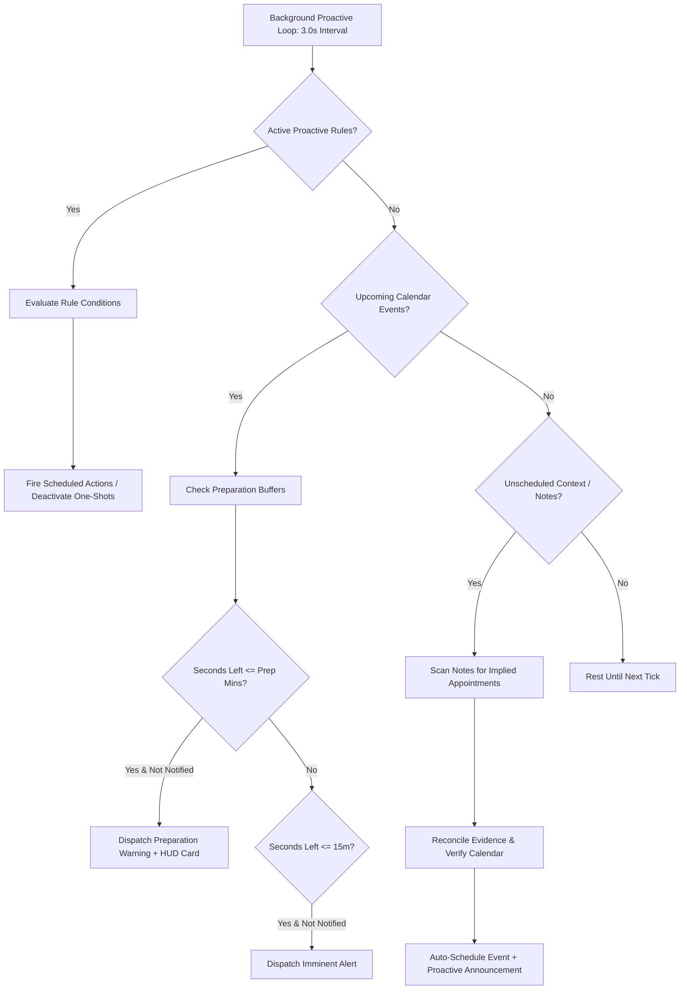

# Core AI — Proactive Autonomous Agency & Anticipatory Engine

```text
========================================================================================
[ SUBSYSTEM: PROACTIVE DAEMON ]   [ STATUS: PRODUCTION ]   [ INTERVAL: 3.0s ]
[ PARADIGM: ANTICIPATORY ]        [ ETISQUETTE: NON-LOCKING ] [ LICENSE: AGPL-3.0-ONLY ]
========================================================================================
```

## 1. The Core Philosophy of Anticipatory Agency

Most legacy AI systems are **strictly passive and reactive**: they sit idle waiting for an operator to type or speak a command. 

As stated in the Core AI directive:
> *"If I have to ask the AI: 'Do I have appointments?', I might as well just look into my calendar. The AI should tell me: 'You mentioned an appointment, but you hadn't put it in your calendar. I checked the evidence, found the details, added it to your calendar, and configured a preparation reminder.' Or it tells me: 'Don't forget: you have an appointment in a few hours, and you need 30 minutes to prepare.' It should feel smart, not a barrier, and never intrude or push on you."*

Core AI breaks through the reactive barrier with an **Autonomous Anticipatory Loop** running continuously in the background microkernel daemon.



---

## 2. Core Components of the Proactive Subsystem

### 2.1 The Proactive Daemon (`brain/proactive.py`)
Runs as a dedicated asynchronous background worker within the microkernel. Every `check_interval_seconds` (default: 3.0s), it evaluates three continuous streams:
1. **Registered Condition-Action Rules**: Countdown timers, hardware vitals thresholds, and spatial state triggers.
2. **Calendar Anticipation Engine**: Looks ahead across scheduled appointments and calculates whether the operator needs to begin preparing based on required preparation minutes.
3. **Unscheduled Evidence Reconciliation**: Scans operator notes and conversational memory for commitments mentioned in passing that never made it onto the formal schedule.

### 2.2 Schedule & Calendar Evidence Reconciliation (`tools/native/calendar_tools.py`)
The reconciliation engine operates on natural language context:
- **Mention Detection**: Identifies expressions like *"dentist tomorrow at 14:00"*, *"team sync at 3pm"*, *"doctor on Friday, bring insurance card"*.
- **Temporal Parsing**: Resolves relative expressions (*"in 2 hours"*, *"tomorrow at 10:00"*, *"today at 15:30"*) into ISO-8601 UTC timestamps.
- **Deduplication Check**: Queries SQLite `calendar_events` to ensure the appointment is not already on the schedule.
- **Preparation Buffer Extraction**: Identifies preparation tasks (*"review slides"*, *"bring passport"*, *"prepare x-rays"*) and reserves the appropriate buffer window (default: 30 minutes).
- **Autonomous Enrollment**: Writes the record to SQLite, assigns `source="reconciliation"`, and preserves the original `evidence_text` for full accountability.
- **Transparent Report**: Informs the operator clearly:
  > *"You mentioned you had an appointment ('Dentist'), but it wasn't on your calendar. I checked the evidence, found the details for 2026-10-17 14:00 UTC, added it to your calendar, and configured a 30-minute preparation alert."*

### 2.3 Preparation Buffers & Dual-Stage Event Warnings
Standard calendar apps sound a generic ding 5 minutes before a meeting. By then, it is already too late if the meeting required 45 minutes of preparation or travel.

Core AI implements **Dual-Stage Anticipatory Notifications**:
1. **Stage 1: Preparation Warning**:  
   Fires exactly when `remaining_time <= preparation_minutes`.  
   *Example*: *"Hey Dyvorn, your appointment 'Quarterly Review' is in 45 minutes. You have 30 minutes set aside to prepare: Review architectural RFC and benchmark slides."*
2. **Stage 2: Imminent Notice**:  
   Fires 10-15 minutes prior to the start time as a final prompt.  
   *Example*: *"Hey Dyvorn, 'Quarterly Review' starts in 15 minutes."*

Each stage sets a persistent database flag (`prep_notified=1`, `imminent_notified=1`) ensuring that notifications **never loop or repeat**.

---

## 3. Non-Intrusive Etiquette & Zero-Locking Architecture

A proactive system that annoys, nags, or interrupts the user is worse than no system at all. Core AI enforces strict non-intrusive etiquette:

### 3.1 Non-Locking Concurrency
- All database operations utilize SQLite **Write-Ahead Logging (WAL)** with `PRAGMA busy_timeout = 30000` and Python `timeout=30.0`.
- The proactive loop runs asynchronously and never holds transactions open while computing plans or synthesizing speech.
- Terminal REPL and CLI one-shot tasks are never blocked by background daemon reasoning.

### 3.2 Tiered Delivery Channels
Proactive events format themselves dynamically via `AdaptiveResponseEvent`:
- **Ambient HUD Card**: Projected to connected mirrors, secondary studio monitors, or glasses HUD without making sound.
- **Lock-Screen Glance**: Forwarded to the mobile companion app lock screen.
- **Subtle Audio Speech**: Delivered through the room sound system or headphones only when high priority or when the room is active.

### 3.3 One-Shot Auto-Deactivation
Countdown timers and relative reminders automatically set `is_active = 0` in SQLite immediately upon firing, guaranteeing that stale rules never linger as zombie processes.
