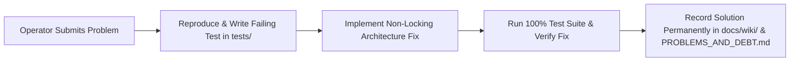

# Core AI — Guide: Submitting Issues & Solutions to the Wiki

```text
========================================================================================
[ WORKFLOW: PROBLEM & SOLUTION SUBMISSION ]   [ TARGET: docs/wiki/ & docs/PROBLEMS_AND_DEBT.md ]
[ STANDARD: #ANTISLOP TEST-DRIVEN ]            [ STATUS: ACTIVE ]
========================================================================================
```

## 1. The Zero-Unresolved-Problems Directive

In Core AI, **no technical problem is left undocumented, and no bug is ever closed without a tested, permanent solution recorded in the Wiki**.

If you hit an issue that is not yet answered in [TROUBLESHOOTING_AND_SOLUTIONS.md](TROUBLESHOOTING_AND_SOLUTIONS.md), follow this standard workflow to submit it. We will investigate the root cause, write an automated unit test, implement the fix, and publish the verified solution directly into the Wiki.

---

## 2. Standard Submission Template

When submitting a new problem, provide the following details:

```markdown
### Problem Title: [Short, descriptive name of the issue]

1. **Environment & Operating System**:
   - OS: [e.g. Windows 11 23H2 / Ubuntu 24.04 LTS / Raspberry Pi OS 64-bit]
   - Python Version: [e.g. Python 3.13.2]
   - Audio Interface / Hardware: [e.g. Focusrite Scarlett 2i2, Realtek HD Audio, USB Mic]
   - Core AI Version: [e.g. v0.2.3]

2. **Observed Symptom**:
   - Exactly what happened, including terminal output, error logs, or screenshot.
   - Example error: `sounddevice.PortAudioError: Invalid sample rate [PaErrorCode -9997]`

3. **Reproduction Steps**:
   1. Run command: `core start`
   2. Speak prompt: `...`
   3. Note failure point: `...`

4. **Relevant Log Snippet**:
   - Attach lines from `logs/core_ai.log` or console output.

5. **Proposed / Tested Fix (If known)**:
   - If you found a workaround or patch, include the diff or code snippet here.
```

---

## 3. How We Process and Resolve Submissions

Every submitted issue follows a 4-step pipeline:



1. **Reproduce & Codify**: We create a dedicated reproduction test in `tests/` that reliably triggers the failure.
2. **Implement Non-Locking Fix**: The bug is fixed in accordance with Core AI's non-locking, anti-slop guidelines.
3. **Verify Zero Regressions**: The entire test suite (`pytest`) is executed to ensure 100% green status across all test modules.
4. **Publish to the Wiki**: The issue is assigned an ID (e.g. `Issue #014` or `Category A.5`), and the symptom, root cause, and verified step-by-step resolution are merged into [TROUBLESHOOTING_AND_SOLUTIONS.md](TROUBLESHOOTING_AND_SOLUTIONS.md).

---

## 4. Where to Submit

- **GitHub Repository**: Open an Issue using the template above at [Core AI GitHub Issues](https://github.com/Dyvorn/Core-AI/issues).
- **Direct Terminal REPL**: Speak or type:
  ```bash
  core "save note bug_report: [brief description]"
  ```
  Core AI will log the issue into the persistent knowledge store for automatic analysis.
